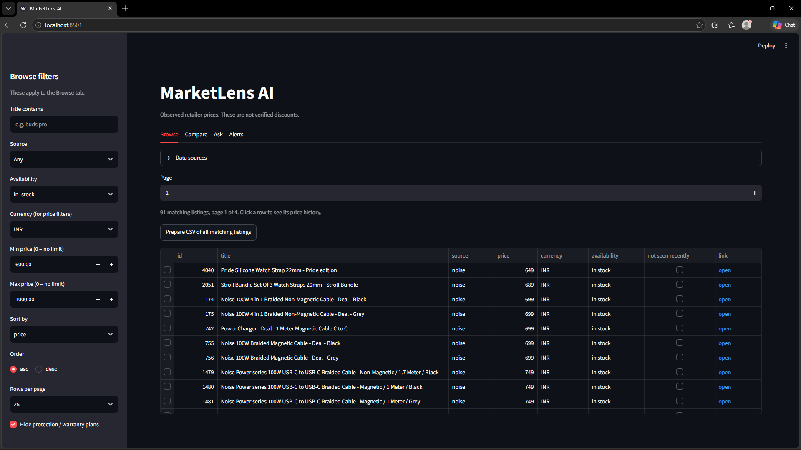
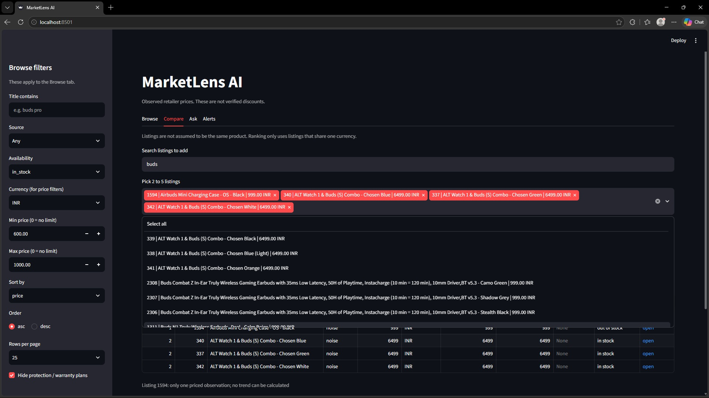
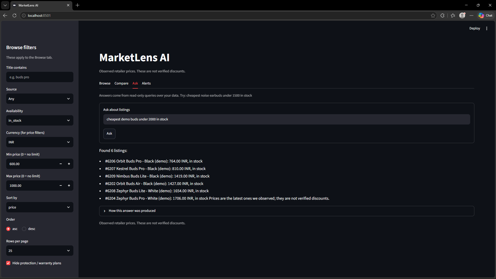
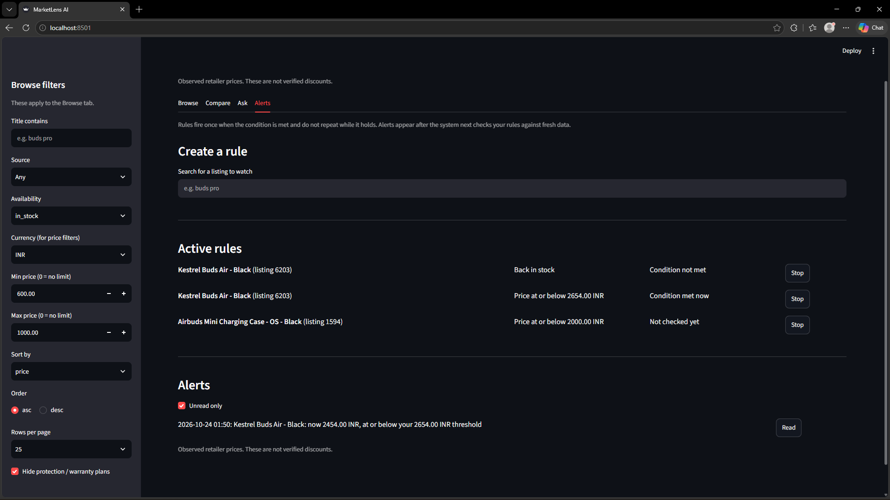
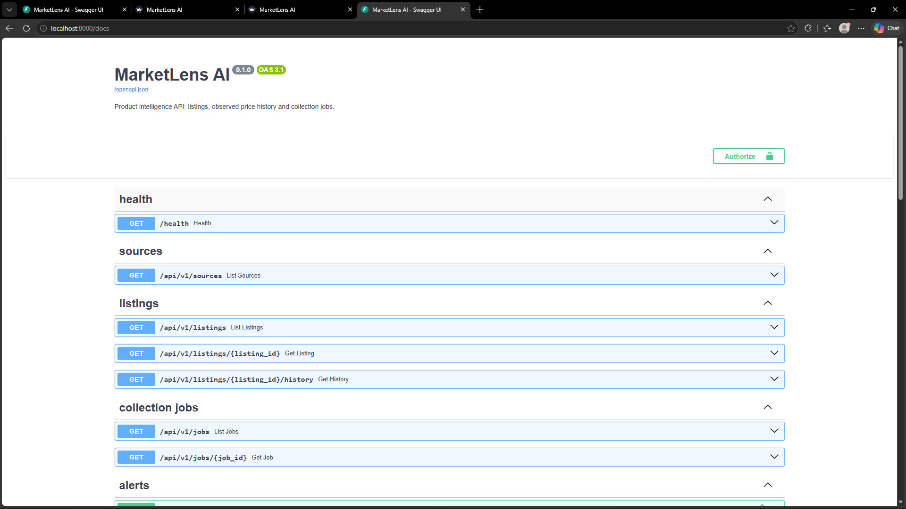

# MarketLens AI

[](https://github.com/saiteja305780/marketlens-ai/actions/workflows/tests.yml)

Product intelligence and price monitoring for consumer electronics. MarketLens collects product listings from retailer catalogs, stores a price history in PostgreSQL, and serves it through a REST API and a Streamlit dashboard.

> Prices shown are **observed retailer prices**. They are not verified discounts.

## Screenshots

| Browse | Compare |
|---|---|
|  |  |

| Ask | Alerts |
|---|---|
|  |  |

API documentation (FastAPI / OpenAPI):



## Features

- **Browse** listings with filters (title, source, availability, currency, price range), sorting and pagination
- **Price history** for every listing, kept as observations over time
- **Compare** several listings side by side
- **Ask** questions about the stored data in plain language
- **Alerts**: price alert rules and the alerts they raise
- **CSV export** of filtered listings, with protection against spreadsheet formula injection
- **Stale detection**: a listing not seen for 48 hours (configurable) is flagged as stale
- **Scheduler** for periodic collection, off unless explicitly enabled
- **Demo mode** with an invented dataset, so the project runs without scraping anything

## Tech stack

Python, FastAPI, Pydantic, SQLAlchemy, Alembic, PostgreSQL, APScheduler, Streamlit, pytest, Docker

## Quick start with Docker

Requires Docker Desktop. This starts PostgreSQL, the API and the dashboard, loaded with **invented demo data only**.

```bash
docker compose up --build
```

| Service | URL |
|---|---|
| Dashboard | http://localhost:8501 |
| API docs | http://localhost:8000/docs |

Stop it with `docker compose down`. Add `-v` to also delete the demo database.

The credentials in `compose.yaml` are throwaway demo values. The database is not exposed outside Docker, so it will not clash with a PostgreSQL already running on your machine.

## Run locally (without Docker)

1. Create a virtual environment and install dependencies:

   ```bash
   python -m venv .venv
   .venv\Scripts\activate        # Windows
   pip install -r requirements.txt
   ```

2. Copy `.env.example` to `.env` and set `DATABASE_URL` (and `API_KEY`, see below). Never commit `.env`.

3. Create the tables and the demo data:

   ```bash
   alembic upgrade head
   python scripts/seed_demo.py
   ```

4. Start the API and the dashboard in two terminals:

   ```bash
   uvicorn app.main:app --reload
   streamlit run dashboard/app.py
   ```

## Configuration

Settings are read from environment variables or a `.env` file.

| Variable | Default | Purpose |
|---|---|---|
| `DATABASE_URL` | none (required) | PostgreSQL connection string |
| `API_KEY` | none | Shared secret for write and alert endpoints. If unset, those endpoints answer 503 |
| `SCHEDULER_ENABLED` | `false` | Turns on in-process scheduled collection |
| `COLLECT_INTERVAL_HOURS` | `6` | Hours between scheduled collections (minimum 1) |
| `STALE_AFTER_HOURS` | `48` | Age after which a listing is flagged stale |
| `HTTP_TIMEOUT_SECONDS` | `15` | Timeout for outgoing requests |
| `HTTP_USER_AGENT` | project default | Identifies the collector honestly. Put your own contact address in it |
| `LOG_LEVEL` | `INFO` | Logging level |
| `APP_ENV` | `development` | Environment name |

## Collecting real data

Real sources are separate from the demo data and are never touched by the demo seed.

```bash
python scripts/preflight.py <store-url>      # check whether a store catalog may be read
python scripts/run_source.py --source <name> # run one source
python scripts/collect.py --source <name>    # collect one source into PostgreSQL
```

Use `--fixture <file>` with `run_source.py` to parse a saved JSON file instead of fetching.

### Responsible data collection

- Only publicly accessible catalog data, collected by permitted methods
- A preflight check before reading a store's catalog
- An honest, identifiable `User-Agent`
- No login-gated or access-controlled sources

## Project layout

```
app/
  api/          FastAPI routes and API-key auth
  assistant/    Ask feature (planner, tools, formatters)
  core/         Settings
  database/     Models and sessions
  schemas/      Pydantic schemas
  scrapers/     Source definitions and registry
  services/     Queries, comparison, alerts, CSV export, ingest, scheduler
dashboard/      Streamlit app (Browse, Compare, Ask, Alerts)
migrations/     Alembic migrations
scripts/        Collection, preflight and demo-data scripts
tests/          pytest suite
```

## Tests

```bash
pytest
```

## License

MIT. See [LICENSE](LICENSE).
